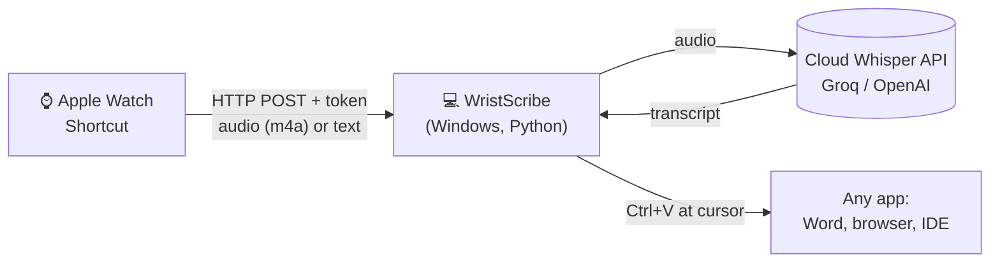

# WristScribe

**Speak into your Apple Watch. The text appears wherever your cursor is on your laptop.**

WristScribe turns an Apple Watch into a wireless dictation mic for Windows. You tap a
complication, talk, and a few seconds later the transcript is typed into Word, Gmail,
VS Code, or whichever app has focus. It's the Wispr Flow idea with the mic on your wrist.

<!-- Demo: record a 10-second GIF (e.g. with ScreenToGif) and save it as docs/demo.gif -->
<!--  -->

## How it works



1. A Shortcut on the watch records your voice (or uses Apple's built-in dictation).
2. It sends the recording to WristScribe over your local network, with a secret token.
3. WristScribe sends the audio to a Whisper speech-to-text API. A glossary of
   domain words (Simulink, SolidWorks, KUKA...) is sent with it so they're spelled right.
4. The transcript is pasted at the cursor. Your previous clipboard is restored afterwards.

## Features (v0.1)

- **Two input modes:** a raw recording goes to `/audio` (cloud Whisper); dictation the watch already transcribed goes to `/text`
- **Provider-agnostic speech-to-text:** Groq (free tier), OpenAI, or any OpenAI-compatible endpoint
- **Custom vocabulary** so technical terms come out spelled correctly
- **Types into any app:** clipboard paste with restore, or simulated keystrokes
- **Token auth:** requests without the shared secret are rejected
- **No Mac needed:** the watch side is a Shortcut, so the whole setup works with only Windows + iPhone
- **One-click Windows launcher:** `start-wristscribe.bat` sets up and starts everything

## Quick start (Windows)

**You need:** Windows 10/11, [Python 3.11+](https://www.python.org/downloads/), an iPhone
paired with an Apple Watch, both on the same Wi-Fi as the laptop, and a free
[Groq API key](https://console.groq.com/keys).

1. Download this repo (green **Code** button → **Download ZIP**) and unzip it.
2. Double-click **`start-wristscribe.bat`**. The first run installs the dependencies, asks
   for your Groq key, and prints the URLs and token for the watch. Click **Allow** when
   Windows Firewall asks (Private networks).
3. Build the watch shortcut: **[docs/apple-watch-setup.md](docs/apple-watch-setup.md)** (about 5 minutes).
4. Click into any text box, tap the shortcut on your watch, and speak.

<details>
<summary>Command-line usage</summary>

```bash
pip install -e .
python -m wristscribe init                 # create config.toml with a fresh token
python -m wristscribe run                  # start listening (default command)
python -m wristscribe run --dry-run        # print dictations instead of typing
python -m wristscribe send "hello world"   # simulate the watch from the laptop
python -m wristscribe transcribe clip.m4a  # check your API key with a local file
```
</details>

## Configuration

`config.toml` is created by `init`. The main settings are:

| Setting | Default | What it does |
|---|---|---|
| `server.port` | `8765` | Port the watch connects to |
| `server.token` | random | Shared secret; the shortcut sends `Authorization: Bearer <token>` |
| `transcription.provider` | `groq` | `groq`, `openai`, or `custom` |
| `transcription.language` | `en` | ISO code, or empty for auto-detect |
| `transcription.vocabulary` | robotics terms | Words to spell correctly |
| `output.mode` | `paste` | `paste` (clipboard + Ctrl+V), `type` (keystrokes), `print` |
| `output.append_space` | `true` | Adds a space after each dictation so consecutive ones don't run together |

The API key can go in `config.toml` or the `WRISTSCRIBE_API_KEY` environment variable.

## HTTP API

Every request needs the token as `Authorization: Bearer <token>`, `X-WristScribe-Token: <token>`, or `?token=<token>`.

| Method | Path | Body | Response |
|---|---|---|---|
| `GET` | `/ping` | none | `{"ok": true, "version": "0.1.0"}` |
| `POST` | `/text` | JSON `{"text": "..."}`, form field `text`, or plain text | `{"ok": true, "text": "..."}` |
| `POST` | `/audio` | raw audio file (m4a/mp3/wav/webm/ogg/flac) or multipart upload | `{"ok": true, "text": "...", "transcribe_ms": 840}` |

Errors return `{"ok": false, "error": "..."}` with status 400, 401, 404, 413 or 502.

## Design decisions

- **A Shortcut instead of a native watchOS app.** Building a watchOS app requires Xcode,
  which needs macOS. A Shortcut can record or dictate and make HTTP requests, and it
  syncs from the iPhone, so the project has no Mac dependency. The receiver's HTTP API
  is client-agnostic: a native SwiftUI watch app can replace the Shortcut later with no
  changes on the laptop.
- **Cloud transcription through an OpenAI-compatible client.** Groq and OpenAI expose the
  same `/audio/transcriptions` API, so one small client supports both, plus
  self-hosted servers. Groq's `whisper-large-v3-turbo` is fast and free for personal use.
- **Format sniffing over trusting headers.** The audio format is detected from the file's
  magic bytes, so mislabeled uploads still work. Formats the API can't take (e.g. CAF)
  fail early with a clear message instead of an opaque API error.
- **Paste, then restore the clipboard.** Simulated keystrokes are slow for long text and
  get mangled by some apps and keyboard layouts. Pasting is instant everywhere, so
  WristScribe saves your clipboard text and puts it back afterwards.
- **Serialised output.** Each request runs on its own thread, but insertion is
  behind a lock so two dictations can never interleave keystrokes.
- **Standard library HTTP server.** The server uses no web framework, which keeps installs
  small for non-developers. Multipart and chunked uploads are handled explicitly and covered by tests.

## Development

```bash
pip install -e ".[dev]"
pytest
```

The test suite covers the HTTP layer, auth, every body format (JSON / form / multipart /
chunked / binary), the speech API client against a local fake API, and config validation.
CI runs it on Windows.

```
wristscribe/
  server.py        HTTP endpoints, auth, body parsing
  dictation.py     core flow: audio/text -> clean text -> output (no HTTP)
  transcriber.py   OpenAI-compatible speech-to-text client + format sniffing
  output.py        paste / type / print at the cursor
  config.py        TOML config loading and validation
```

## Roadmap

- [ ] **AI cleanup pass**: remove filler words, fix punctuation, apply formatting (the main thing that makes Wispr Flow output read well)
- [ ] Voice commands ("new line", "delete that", "send")
- [ ] System tray icon, start with Windows, notification on each dictation
- [ ] Single-file `.exe` (PyInstaller) so no Python install is needed
- [ ] Dictation history and "undo last insert"
- [ ] Filter Whisper's known silence artefacts ("Thank you.")
- [ ] Relay mode for networks that block device-to-device traffic
- [ ] Native SwiftUI watchOS app (needs a Mac, or CI builds + Apple Developer account)

## Privacy

Audio goes only to the speech API you configure (see the [Groq](https://groq.com/privacy-policy/) or
[OpenAI](https://openai.com/policies/privacy-policy/) policies). WristScribe stores no audio or
transcripts on disk. Watch-to-laptop traffic is plain HTTP on your local network, so use it on
networks you trust. See the [security note](docs/apple-watch-setup.md#security-note).

## License

MIT © 2026 Jeyasuriya Ilango
